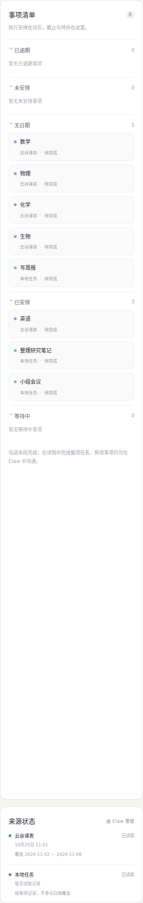
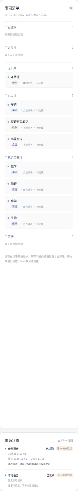
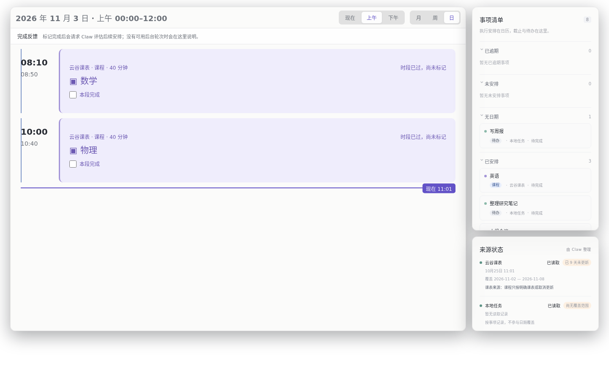
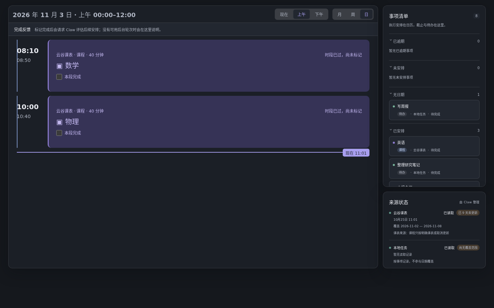

# Agenda 来源维护课程（M18，2026-11-03）

状态：**已部署并验证**。外部源码提交 `1eab93a0116b1cff455ef614888614e77efdf99f`（`~/repos/agenda`，
分支 `feat/m18-source-owned-courses`，基于 `3d275df`）的构建已复制到
`~/.openclaw/extensions/agenda`，经原生 `plugins reload` 生效；Gateway 健康 OK，网站 revision
部署前后均为 **179**。本包**没有导入或取消任何课程、没有发送测试消息、没有改 live 数据库**。

## 1. 用户要求与落点

用户要求：脚本自动获取课表；课程默认不可更改，只有明确取消信息才能从 Agenda 拿掉；课程与待办分类型；
Agent 用「读取时间段 / 写入时间段」安排时间，输入和错误输出要清楚。权威源码在 `~/repos/agenda`，
AgileClaw 不是 Agenda owner。

采用 M16 最小设计，**不新增表、不加 item kind、不升 schema（保持 v2）**：

| 能力                  | 实现                                                                                                                       | 位置（外部仓库）                                  |
| --------------------- | -------------------------------------------------------------------------------------------------------------------------- | ------------------------------------------------- |
| 唯一 owner            | 仍是 Agenda store/worker；`sync` 与 `apply` 都走同一事务/回执                                                              | `src/sqlite.worker.ts`                            |
| 课程 = 来源维护 event | `source.managedBy:"source"` + `item.cancelEvidence`                                                                        | `src/types.ts`, `src/model.ts`                    |
| 读时间段              | `read` 返回 `range`：blocks、scheduled/fixed/unscheduled、逐源 coverage（含 `stale`）                                      | `src/sqlite.worker.ts`                            |
| 写时间段              | `apply` 拒绝与课程/固定事件/锁定块重叠（`time_conflict` + `conflicts`）；`allowOverlaps` 才放行有意并行                    | 同上                                              |
| 课程不可改            | `apply` 对来源维护的 item/块/取消/解锁/来源记录一律 `source_owned`                                                         | 同上                                              |
| 确定性同步            | `sync`：稳定 occurrence 身份（槽位开始时间）、按块开始时间收养旧条目、缺席不删、证据才取消、内容不变不 bump revision       | 同上                                              |
| 调用面                | 工具 `action:"sync"`；本机脚本用 `POST /agenda/api/sync`（与反馈同一 CSRF/同源契约，512 KiB 上限，写入仍发生在插件进程内） | `src/tool.ts`, `src/http.ts`                      |
| 取消证据              | `{kind:platform\|notice\|user, detail, observedAt}`，空 detail 直接被 schema 拒绝；槽位消失不算                            | `src/model.ts`                                    |
| UI                    | 已结束课程进折叠「已结束安排」而非「无日期」；课程/会议/待办标签与类型筛选；来源陈旧徽标；课程详情写明"来源维护、不可改期" | `web/app.ts`, `web/calendar.ts`, `web/styles.css` |
| 后台 owner            | 反馈优先唤起启用的 `sentinel`，其停用时回退启用的 `collector`；两者都不可用则写清楚的可行动错误，不伪造自动重排            | `src/replanner.ts`                                |

同步语义（与 M19 对齐）：身份 = 槽位标准化开始时间；改名保持同一 item，改时间生成新 occurrence 并把旧的
列入 `unlisted`（不删除）；`ok:false` 周不带 slots，覆盖只由最近一段连续成功周推导，失败周把来源置为
`error` 并点名区间；同一 `operationId` + 相同内容幂等重放，内容变化必须换 id（否则
`operation_id_reused`）；`sync` 不需要 `expectedRevision`。没有 `cancelEvidence` 的 cancelled 记录
不能压掉课程：sync 会把它恢复为 pending 并在回执 `restored` 中列出；只有带证据的取消才保留。

**预合并复审修复（P1）**：原实现只拦截「修改既有 source-owned item」，允许把普通/新建 item 放进
`managedBy:"source"` 的来源，并可预置 `cancelled` + 未来 sourceKey 让后续 sync 跳过。现在
`apply` 对所有 `incoming.sourceId` 属于 source-owned 来源的新建/跨来源迁入/修改一律 `source_owned`；
`sync` 对无证据的 cancelled 条目恢复课程。回归用例覆盖：新建、跨来源迁入、预置 cancelled（无证据恢复 /
有证据保留），均为真实 store 测试。

## 2. 外部仓库提交与可重放证据

| 项           | 值                                                                                    |
| ------------ | ------------------------------------------------------------------------------------- |
| 仓库 / 分支  | `~/repos/agenda` · `feat/m18-source-owned-courses`                                    |
| base         | `3d275dfea5f961c8419388d8750c83ed33c5f640`（main）                                    |
| commit       | `1eab93a0116b1cff455ef614888614e77efdf99f`                                            |
| tree         | `a2271dd8ca73ed697b4aa754dfd18c5de59b2d84`                                            |
| 补丁         | `external/source.patch`（`git format-patch --stdout`，2 个提交，16 文件，+2202/−159） |
| 构建产物哈希 | `external/files.json`（7 个安装文件）                                                 |
| 部署记录     | `external/deploy-record.json`、`external/deploy-backup-metadata.json`                 |

外部改动只发生在 wt-18 内的隔离 worktree：`.tower/worktrees/wt-18/.external/agenda`（node_modules
软链到 `~/repos/agenda/node_modules`，`~/repos/agenda` 主工作区未改动、仍停在 `3d275df`）。

`bash verify/replay-tests.sh ~/repos/agenda` 在 `3d275df` 上 `git am` 本补丁（2 个提交），得到相同 tree，
`node build.mjs` + `npx vitest run` 全绿（45 tests / 5 files）。`node verify/check-package.mjs
--source <built checkout>` 的 21 项证据检查全部通过。

## 3. 测试覆盖（外部仓库 `pnpm build && pnpm test` 等价）

- `src/sync.test.ts`（7）：创建锁定课程并按块开始时间收养旧条目；改名不换身份；相同内容不 bump revision；
  缺席只报 `unlisted`；无证据取消被拒、有证据取消并删块、重复取消幂等；跨周槽位/重复 occurrence/取消与
  槽位冲突整体拒绝且零写入；覆盖只来自连续成功周；来源记录与课程/块的 `source_owned` 拒绝；
  `time_conflict` 结构化冲突与 `allowOverlaps`；区间读摘要；已完成课程历史不被后续同步改写。
- `src/store.test.ts`（7，原有）：幂等、revision 冲突、v1→v2 备份迁移、锁定/固定事件、用户完成保护。
- `src/http.test.ts`（7）：sync 路由的 403/400/405/200、写入留在 store 内、revision 发布、原有反馈链路。
- `src/replanner.test.ts`（15）：sentinel 停用回退 collector、两者停用的可行动错误、既有时序/预留/关闭。
- `web/calendar.test.ts`（7）：已结束课程不进「无日期」、课程/会议/待办分类、陈旧来源标签、覆盖语义。

全量结果：**5 files / 45 tests passed**（`pnpm test`，约 5 秒）；其中 `src/sync.test.ts` 9 项，含上述 P1 回归。

额外用**已部署的** `dist/src/sqlite.worker.js` 对 live 数据库的 `VACUUM INTO` 副本做了一次真实形状验收
（不触碰 live）：副本 383 items / 139 门课程 / revision 179 → 一次 sync 收养 1 条、0 新建、revision 180，
课程块全部锁定、来源 `managedBy:"source"`；同内容重放 `changed:false`、revision 仍为 180；课程数保持 139。
证明旧 data 的收养与幂等语义在部署产物上成立。

类型检查说明：`pnpm typecheck` 依赖宿主私有 SQLite facade 的声明构建
（`OPENCLAW_BUILD_PRIVATE_QA=1 pnpm build:plugin-sdk:dts`）。本次该声明构建在共享 AgileClaw
checkout 中失败（`Declaration build failed with exit code 1`），因此无法完成全量类型检查；
`npx tsc --noEmit` 仅报告这两个 facade 缺声明及其连带的 implicit-any，无本项目类型错误。
构建（esbuild）与全部运行时测试通过。这是环境/宿主构建问题，非本包改动。

## 4. UI 证据（合成数据，无个人内容）

截图脚本 `verify/screenshot.mjs` 用同一份合成课表（3 门今日课程、2 门昨日课程、1 个待办块、1 个无日期待办、
1 个会议、1 个 9 天未更新的课表来源）分别喂给 **改动前**（`3d275df` 构建）与 **改动后** 的静态资源，
Playwright 截图后人工查看：

| 改动前                                                   | 改动后                                                            |
| -------------------------------------------------------- | ----------------------------------------------------------------- |
|  |             |
| 无日期 5（4 门已结束课程 + 1 个待办），无类型/陈旧提示   | 无日期 1；已结束安排 4；课程/会议/待办标签；来源「已 9 天未更新」 |

桌面版今日半天视图（浅色/深色）：





周视图（浅色）：`verify/screenshots/after-week-light.png`；对应改动前：`before-*.png`。
课程卡片显示「云谷课表 · 课程 · 40 分钟」与锁定标记，来源面板另标「课表来源：课程只按明确课表或取消更新」。

## 5. 部署记录

```bash
cd ops/agenda-course-schedule
node scripts/status.mjs --source ../../.external/agenda      # 只读差异
node scripts/deploy.mjs --source ../../.external/agenda      # 计划
node scripts/deploy.mjs --source ../../.external/agenda --yes
```

2026-11-03T03:16:23Z（P1 修复后的最终部署）实际执行结果：

- 部署前备份：`~/.openclaw/backups/agenda-course-schedule/2026-11-03T03-16-23-277Z`
  （上一版 `dist/`、`assets/`、`skills/`、manifest，外加 VACUUM INTO 数据库快照
  `agenda.sqlite.snapshot`，sha256 `f47a039ad0c93f48fe4d87fcbd1891af3e268d771b4be41f5c58efb1bc499d51`）；
- 源提交与 7 个产物哈希在复制前校验；
- `openclaw plugins reload agenda --wait --json`：ok；
- `openclaw gateway health`：OK；
- `/agenda/api/status` revision **179 → 179**（无数据写入）；
- 7 个安装文件逐字节匹配 `external/files.json`；线上 `app.js` sha256 `15916c51…`（UI 未变，截图仍有效）；
- 用已部署 worker 对 live 库副本验收：139 门课程收养 1 条、0 新建、revision 179→180，重放
  `changed:false`；随后向 `yungu-schedule` 新建 item 的 apply 被拒 `source_owned` 且 revision 仍 180；
- 线上区间读返回新 `range` 摘要（今日 0 blocks / 162 unscheduled / coverage 未覆盖，逐源 `stale`），
  `GET /api/sync` = 405、无凭据 `POST /api/sync` = 403。

**live 数据变化：无。** 未调用一次成功 sync，未改任何 item/block/source，未取消课程，未发消息。
部署前后 revision 相同即为证据。

## 6. 回滚

```bash
# 只回退 P1 修复（回到上一版 M18 构建）：
scripts/rollback.sh ~/.openclaw/backups/agenda-course-schedule/2026-11-03T03-16-23-277Z
# 整体回退到 M18 之前的 main 构建：
scripts/rollback.sh ~/.openclaw/backups/agenda-course-schedule/2026-11-03T03-04-02-920Z
```

脚本只恢复 `dist/assets/skills/openclaw.plugin.json` 并 reload；**不恢复数据库**。快照仅作证据与人工
恢复材料（v2 数据库与 WAL 家族必须成对处理）。新版本与 v2 schema 完全兼容，回滚不需要数据库操作。

## 7. 与 M19 的接口

M19 的 collector 用本机 HTTP 路由写课表，刻意避免脚本直接开 SQLite：

1. `GET http://127.0.0.1:18810/agenda/api/session` → `{csrfToken}`（无 cookie 绑定）；
2. `POST http://127.0.0.1:18810/agenda/api/sync`，头 `Content-Type: application/json`、`Origin`
   与请求 Host 完全一致（`http://127.0.0.1:18810`）、`X-Agenda-CSRF`；
3. body 为 `{operationId, sourceId, label?, window, weeks[], cancellations?}`；`changed:false` 视为成功刷新；
   `operationId` 按「同窗口同内容」确定性生成，内容变化才换 id。

`sync` 的归属语义：首次 sync 会把该来源标为 `managedBy:"source"`，此后该来源下**所有**事项对 Agent
只读（包括历史上以 agent 身份登记的条目）。当前 `yungu-schedule` 的 139 条旧课程正属于这种情况；
首次 sync 会按块开始时间收养它们并换成稳定 key，不产生重复，也不会复活 18 条已取消历史。

## 8. 已知边界 / 后续

- 已有「本段完成」记录的课程 occurrence 视为历史，后续 sync 不改写它的时间/标题，只在回执
  `completedHistory` 中列出；如确需变更，需人工处理。
- 完整 `pnpm typecheck` 仍被宿主私有声明构建阻塞（见第 3 节）；构建、运行时测试、补丁重放均已通过。
- 取消后同一 occurrence 重新出现不会自动复活（保持 cancelled）；恢复需明确的人工/Agent 重开。
- 来源维护的课程块在 UI 仍可「本段完成」（这是完成记录，不是改课）。
- M19 尚未部署/未真实同步；当前线上仍无本周课程，区间读显示 0 blocks 是真实状态。
- 非桌面模式不支持 `?theme=dark`（既有行为，本次未改）。
