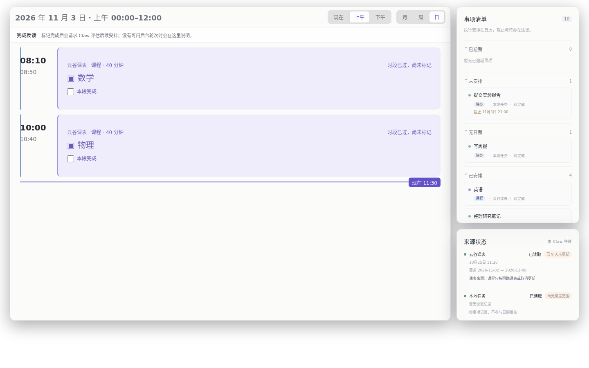
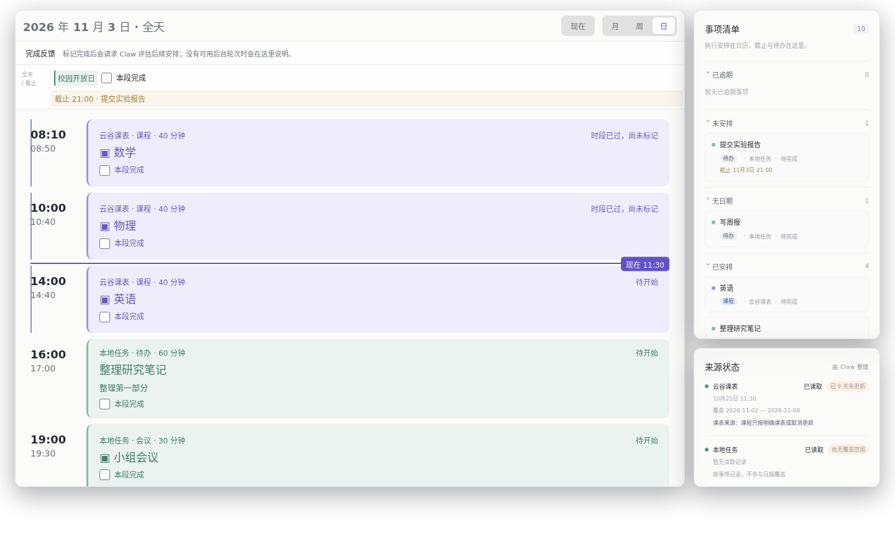
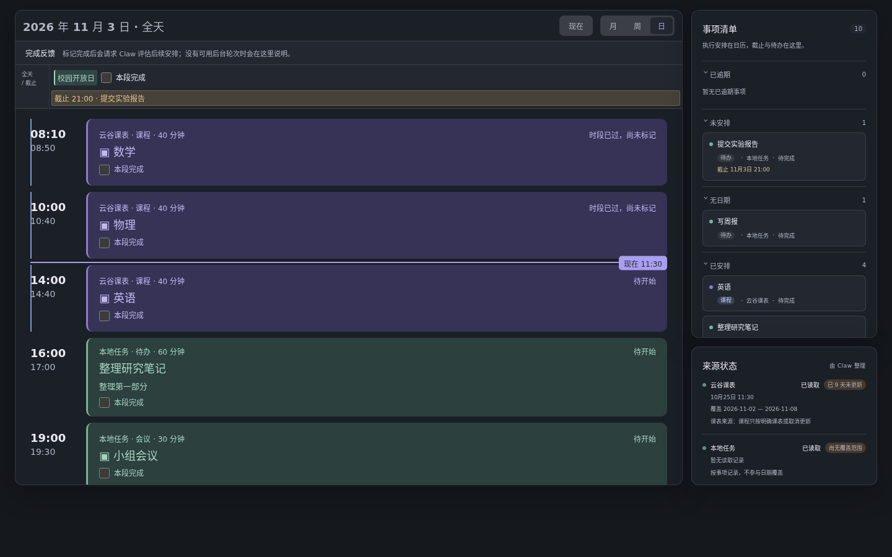
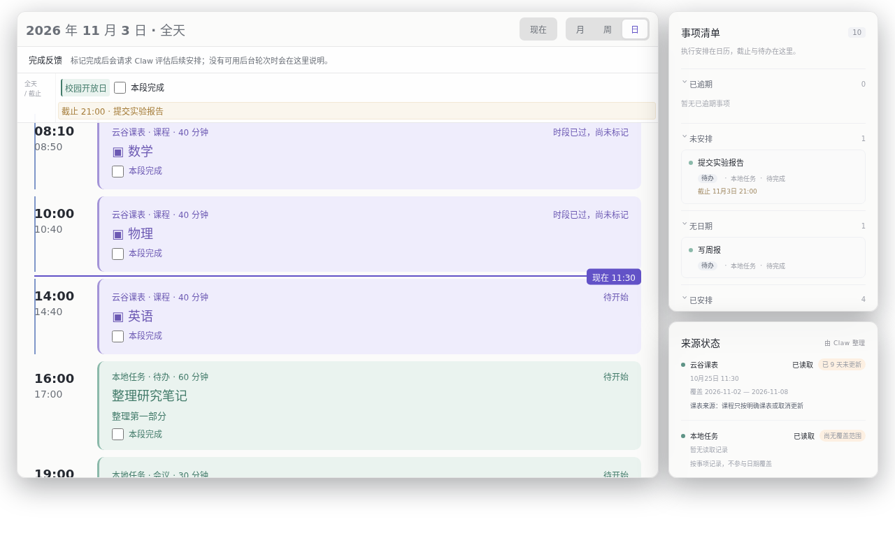
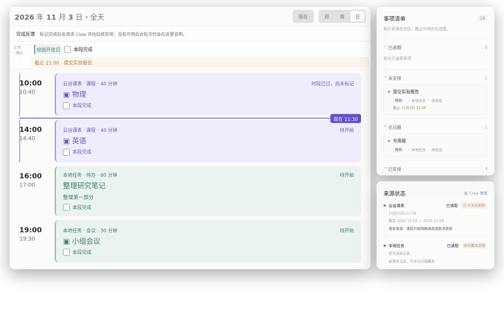

# Agenda 桌面日视图合并为一张全天表（M22，2026-11-03）

状态：**实现、测试、构建、截图与证据包已完成，等待独立复审和合并；尚未部署**。
外部源码基于当前线上/已复审的 M18 tip `53962ec`，不是旧 `3d275df`。本次没有改动任何真实日程、
课表或数据库；观察线上 revision 只用了 `GET /agenda/api/status`（180）。

用户原话：『我需要你迭代一下现在的agenda 的desktop版本，显示当日日程的页面，不用上午下午分开展示，
做到一张表里』。范围仅限 `display=desktop` 的日视图；周/月/移动布局不变。

## 1. 改动

桌面 `?display=desktop` 的日视图不再是「上午 00:00–12:00 / 下午 12:00–24:00」两张表，而是
**同日一张连续表**：

| 项           | 改动                                                                                                      |
| ------------ | --------------------------------------------------------------------------------------------------------- |
| 全天表       | `renderTimeline(..., table=true)` 渲染唯一的 `.agenda-rows`（“全天日程”），所有定时块按开始时间排在同一列 |
| 全天/截止    | 全天事项与截止 chip 保留在表头行；滚动时该行 sticky，始终可见                                             |
| 当前时间     | 保留「现在 HH:MM」标记与自动跟随；滚动会暂停跟随，工具栏「现在」按钮恢复                                  |
| 课程/待办    | 仍使用原卡片、来源颜色、类型标签、锁定标记；未新增竞争实现                                                |
| 详情/完成    | 卡片详情弹窗与「本段完成 / 整项已完成 / 撤销」交互不变                                                    |
| 标题         | `2026 年 11 月 3 日 · 全天`，删除了上午/下午切换按钮                                                      |
| 非桌面日视图 | 仍走原来的 24 小时时间网格；周/月/移动端未改                                                              |

数据侧把一天的表内容收敛到 `web/calendar.ts` 的 `daySchedule()`：定时块（含跨午夜分段）、
全天块、当天截止一次返回；`dueDate()` 也移到该 owner。桌面表不再对 block 做半天裁剪。

修改文件（外部 `~/repos/agenda`）：`web/app.ts`、`web/calendar.ts`、`web/calendar.test.ts`、
`web/styles.css`、`README.md`、`AGENTS.md`。

## 2. 外部提交与可重放证据

| 项            | 值                                                                                      |
| ------------- | --------------------------------------------------------------------------------------- |
| 仓库          | `/home/raymond/repos/agenda`                                                            |
| 隔离 worktree | `.tower/worktrees/wt-22/.external/agenda`（detached）                                   |
| base          | `53962ecd7b02c71aea7420401b2f2ef73b74d3e3`（M18 已复审/已部署 tip）                     |
| commit        | `1c95defae6801c5470924c306e7f191b8181b5e4`                                              |
| tree          | `0c13449bb0b2052101e5abd300355180879d6e63`                                              |
| 补丁          | `external/source.patch`（`git format-patch 53962ec..HEAD`，1 个提交，6 文件，+170/−86） |
| 构建产物哈希  | `external/files.json`                                                                   |
| 提交信息      | `external/commit.txt`、`manifest.json`                                                  |

构建产物中只有网站资源变化；`dist/index.js`、worker、manifest、skill 与已部署 M18 一致：

```text
dist/index.js                 23b86644ca4ca94276ca5ba1096226755df6d42fbb22d9c6efad34098c4556c7
dist/src/sqlite.worker.js     bcc61d93382da511d7b59abda77e1786961eaed724bf649b66d3d7a1af5a9da7
assets/app.js                 302044dd26fe992de53455ab2513b0800f6a075772ca35b3f7aa5b5bb2ba0306
assets/app.css                61b97ed6d2dadbf87ee33c27b55b3dfa611341229d264a5a3c33247511ae4f27
assets/index.html             00b374426c301f71159d39c62ca0308568e5d1ab6fabbc05ecc07ae8bee2c3a6
openclaw.plugin.json          04b03539d7adac5827b681490f2c2f105b47dfefa22f45c41d3a84f5e37b7e79
skills/agenda/SKILL.md        b657103e4ffd2dc61de80152f9cb3ecd9aa472d3c6b3419dff8c6a614cb8a9b2
```

## 3. 验证

```sh
cd .tower/worktrees/wt-22/.external/agenda
pnpm test                         # 5 files / 50 tests passed（新增 3 个 daySchedule 回归）
npx tsc --ignoreConfig --noEmit --strict --target es2022 \
  --module nodenext --moduleResolution nodenext --lib es2023,dom \
  --skipLibCheck web/app.ts web/calendar.ts web/calendar.test.ts   # 通过

cd /home/raymond/repos/AgileClaw/.tower/worktrees/wt-22
bash ops/agenda-desktop-day-view/verify/replay-tests.sh ~/repos/agenda
node ops/agenda-desktop-day-view/verify/check-package.mjs --source .external/agenda
```

结果：

- `pnpm test`：**50 tests passed**（原 47 + 3 个新回归）。
- 补丁在 `53962ec` 上 `git am` 后 tree 完全一致（`0c1344…`），重放构建 + 50 tests 全绿。
- `check-package.mjs` 21 项证据检查全部通过。
- 浏览器断言（`screenshot.mjs --verify unified`）：唯一全天表、无上午/下午切换、标题含「全天」、
  5 个定时行跨 08:10–19:00、全天事项与截止可见、`现在 11:30` 标记存在、5 个完成控件；
  实测打开详情弹窗，并实际点击「本段完成」确认 `POST /agenda/api/feedback`
  提交 `kind:"complete_block"`、`targetId:"course-math-block"`。
- 全量 `pnpm typecheck` 仍被宿主私有 SQLite facade 的 `.d.ts` 缺失阻塞（`sqlite-runtime`、
  `sqlite-worker-runtime` 及其 implicit-any），与 M18 记录的环境问题相同；web 源码单独 strict
  typecheck 无错误。构建与全部运行时测试通过。

## 4. 脱敏截图（合成数据，无个人内容）

合成数据含 3 门今日课程、2 门昨日课程、1 个待办块、1 个会议、1 个全天活动、1 个当天截止，
浏览器时钟固定在 11:30。改动前（`53962ec` 构建）只显示上午的两门课；改动后同一张表显示
08:10–19:00 的全部五个定时块、全天活动和 21:00 截止。

| 改动前 1440×900                                                      | 改动后 1440×900                                                    |
| -------------------------------------------------------------------- | ------------------------------------------------------------------ |
|  |  |

改动后深色模式（1440×900）：



改动后 1280×800（默认跟随当前时间；全天/截止行 sticky）：



同尺寸滚到底部，确认最后一行 19:00 会议仍可到达（表头全天/截止保持可见）：



改动前对应尺寸：`verify/screenshots/before-desktop-light-1280.png`、`before-desktop-dark.png`。

## 5. 部署（复审合并后才执行）

**当前未部署。** 本包不修改数据库。复审通过并合并后：

```bash
cd ops/agenda-desktop-day-view
node scripts/status.mjs --source ../../.external/agenda      # 只读；当前 assets 预期不同
node scripts/deploy.mjs --source ../../.external/agenda      # 计划
node scripts/deploy.mjs --source ../../.external/agenda --yes
```

部署脚本会：校验源 HEAD 与 7 个构建产物哈希 → 备份 `dist/assets/skills/openclaw.plugin.json`
→ `VACUUM INTO` 数据库快照（仅证据，不恢复、不写入）→ 复制 → `openclaw plugins reload agenda
--wait --json` → `openclaw gateway health` → 逐文件哈希比对 → 读取前后 revision。

部署后还需人工/浏览器核验真实 `http://127.0.0.1:18810/agenda/?display=desktop` 当日页面：
唯一全天表、无上午/下午切换、当前时间、全天/截止、详情和完成交互；确认 Gateway/插件健康且
revision 不变（部署前后相同）。如果失败，用 `scripts/rollback.sh <backup>` 只回退构建文件。

## 6. 回滚

```bash
scripts/rollback.sh ~/.openclaw/backups/agenda-desktop-day-view/<stamp>
```

脚本只恢复 `dist/assets/skills/openclaw.plugin.json` 并 reload；**不恢复数据库**。数据库快照仅作
证据与人工恢复材料。v2 schema 未变，回滚不需要数据库操作。

## 7. 已知边界 / 后续

- 1280×800 下 5 个定时行 + 全天行超出一屏，列表内部滚动；sticky 全天行和
  `after-desktop-light-1280-bottom.png` 证明最后一行可到达。1440×900 可一次看全。
- 桌面日视图仍固定显示北京时间的「今天」（既有行为）；本次未扩大为可选择日期，
  点击周视图某天进入日视图仍回到今天。
- 不做 live 部署、不改课表/待办数据，等待独立复审。部署阶段需按本文件记录再次核验真实页面。
